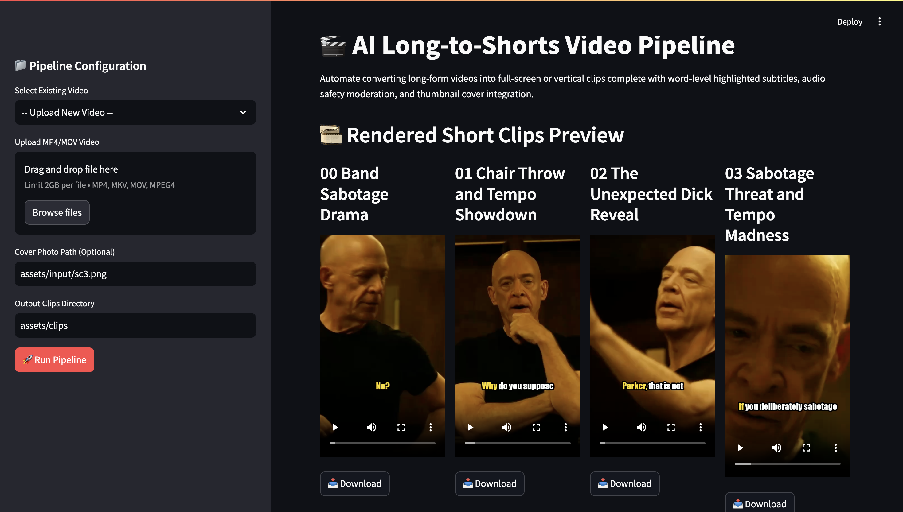
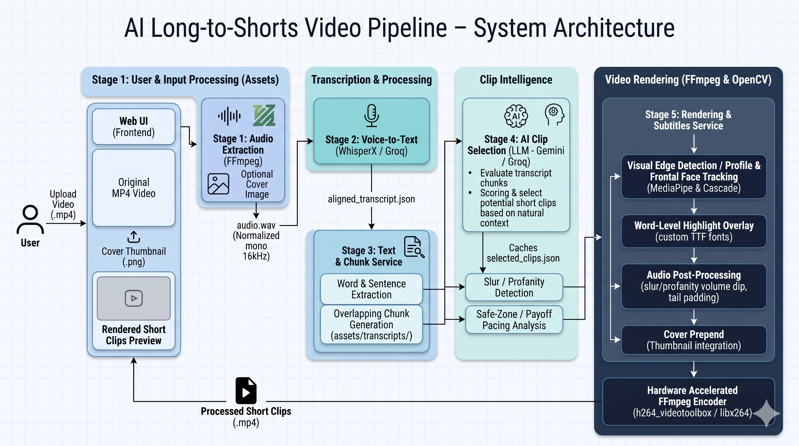

# 🚀 AI-Powered Long-to-Shorts Video Pipeline

An intelligent, end-to-end video processing architecture that automatically converts long-form podcasts and interviews into engagement-optimized vertical clips (Shorts/Reels) complete with word-by-word highlighted subtitles, multi-angle face tracking, and automated platform-safety moderation.

The platform combines **Whisper transcription, semantic LLM chunking, computer vision (OpenCV/MediaPipe), Pillow-based typography, and hardware-accelerated FFmpeg rendering** to transform hours of raw footage into publish-ready viral content in seconds.

---

## 🎯 Problem Statement

With the explosive growth of short-form vertical video, podcast creators and media platforms face a massive content repurposing bottleneck. Extracting highly engaging moments from 1- to 3-hour videos requires hours of manual scrubbing, typography formatting, and compliance checking.

Traditional programmatic and manual workflows struggle with:

- **Time-Intensive Content Discovery:** Finding 30- to 60-second segments with high narrative tension and clean payoffs.
- **Algorithmic Suppression Risks:** Uncensored profanity or severe slurs trigger shadowbans on platforms like Instagram Reels and TikTok.
- **Tedious Formatting:** Manually syncing word-by-word subtitles and adjusting safe zones to avoid platform UI overlap.
- **Rendering Inefficiencies:** Standard CPU processing causes thermal throttling, slow exports, and jarring camera crops during hard scene cuts.

This project solves these bottlenecks by building an automated pipeline that:

1. Normalizes and extracts audio from long-form video.
2. Generates word-level phonetic transcriptions using Whisper.
3. Chunks dialogue and uses LLMs (Gemini/Groq) to select high-retention viral hooks.
4. Programmatically enforces platform safety via automated audio mute dips and text masking.
5. Tracks faces and profiles across hard scene cuts for dynamic 9:16 cropping.
6. Renders bold, UI-safe word-by-word subtitles via a hardware-accelerated FFmpeg pipeline.

---

## 🖥️ Web Interface



---

## 🛠️ Tech Stack & Logical Architecture

- **Frontend & Orchestration:** Streamlit (Interactive web UI) & Python 3.12
- **Transcription Layer:** WhisperX / Whisper (High-precision phonetic mapping)
- **LLM Intelligence:** Google Gemini (`gemini-3.8-flash`) & Groq (`gpt-oss-20b`/`120b`) for semantic clip extraction
- **Computer Vision:** OpenCV (Haar Cascades) & MediaPipe (Multi-angle face and profile tracking)
- **Typography Engine:** Pillow (`PIL.ImageDraw`) for anti-aliased TrueType font burning
- **Video Rendering:** FFmpeg with hardware acceleration (`h264_videotoolbox` / `libx264`)
- **Package Manager:** `uv` by Astral (Lightning-fast environment setup)

### 🏗️ System Architecture Diagram




---

## 🎬 Generated short Output Examples

Below are examples of unedited movie footage automatically converted into 9:16 vertical Shorts using this pipeline. Notice the dynamic face-tracking, the UI-safe bold text, and the semantic completeness of the AI-selected clips.

**Example 1: The Hook & Payoff**  
[https://github.com/user-attachments/assets/video-id-1
](https://github.com/user-attachments/assets/3861f993-fb36-4e91-8d5a-4ed7c0b427ae)
**Example 2: Fast Paced Dialogue & Scene Tracking**  
[https://github.com/user-attachments/assets/video-id-2
](https://github.com/user-attachments/assets/fdae76f7-3ac5-4151-9322-e1be56d81523)
---

## 🛠️ Tech Stack & Logical Architecture
... (the rest of the README continues here)


## System Workflow
The pipeline operates autonomously through the following sequence:

```text
                    Long-Form Video (.mp4)
                             │
                             ▼
              Audio Extraction & Normalization (dynaudnorm)
                             │
                             ▼
              Voice-to-Text Transcription (Word-level Timestamps)
                             │
                             ▼
              Semantic Chunking (Overlapping sliding windows)
                             │
                             ▼
              AI Clip Selection (LLM evaluates hooks & payoffs)
                             │
                             ▼
              Algorithmic Moderation (Slur/Profanity text masking)
                             │
                             ▼
              Visual Intelligence (Scene-cut aware face/profile tracking)
                             │
                             ▼
              Typography Generation (UI-safe, word-highlighted frames)
                             │
                             ▼
              Hardware-Accelerated FFmpeg Rendering (Audio mute dips & crop)
                             │
                             ▼
                    Publish-Ready 9:16 Shorts
```

---

## 📁 Repository Structure

```text
├── assets/               # Local data storage (ignored by git)
│   ├── audio/            # Extracted normalized .wav files
│   ├── clips/            # Final rendered 9:16 short videos
│   ├── input/            # Raw long-form videos and cover thumbnails
│   └── transcripts/      # Cached JSON transcripts and selected clip data
├── backend/              # Core processing logic
│   ├── app/
│   │   ├── config.py     # Environment variables and API keys
│   │   └── services/     # Modular pipeline services (audio, chunk, llm, video, etc.)
│   ├── .venv/            # Isolated Python environment managed by uv
│   └── run.py            # CLI entry point for backend testing
├── docs/                 # Documentation and repository media
│   └── assets/           # Architecture diagrams and UI screenshots
├── .env                  # Secrets (Groq and Gemini API keys)
├── .streamlit/           # Streamlit server configurations (config.toml)
├── app.py                # Main interactive Streamlit frontend
└── pyproject.toml        # Project dependencies
```

---

## 📚 Technical Deep Dives & Documentation

For a closer look at the engineering decisions, core mathematical/architectural principles, and development hurdles behind this platform, check out the dedicated documentation modules:

- **[Core System Concepts &  Theory](assets/proj_detail_info/CORE_CONCEPTS.md)**
- **[Engineering Challenges & Lessons Learned](assets/proj_detail_info/CHALLENGES.md)**

---

## ⚙️ Quick Start Guide

### 1. Prerequisites

Ensure you have the following installed on your machine:
- Python 3.12+
- FFmpeg (Must be available in your system `$PATH`)
- Astral `uv` package manager

### 2. Environment Setup

Clone the repository and set up your environment keys:

```bash
git clone https://github.com/yourusername/AI-Long-to-Shorts-Pipeline.git
cd AI-Long-to-Shorts-Pipeline

cp .env.example .env
```

Open the `.env` file and add your API keys:

```env
GROQ_API_KEY=gsk_your_groq_api_key
GEMINI_API_KEY=AIzaSy_your_gemini_api_key
```

### 3. Install Dependencies

Use `uv` to install the project dependencies inside the backend environment:

```bash
uv sync --project backend
```

### 4. Run the Web Application

Launch the Streamlit frontend to interact with the pipeline:

```bash
uv run --project backend streamlit run app.py
```

Open your browser and navigate to `http://localhost:8501` to upload a video and begin generating clips.

---

## 📊 Core Features

- **Scene-Cut Aware Framing:** Intelligent cropping that snaps to active speakers without blurring or lagging across camera edits.
- **Word-Level Karaoke Subtitles:** Generates bold, high-contrast, stroke-outlined text at 68% screen height to avoid Instagram/TikTok UI elements.
- **Dynamic Audio Normalization:** Casts a wide net on dynamic range (`dynaudnorm`), ensuring whispered dialogue is transcribed accurately.
- **Payoff Pacing Analysis:** Automatically extends clip endings by up to 5 seconds if a concluding sentence or punchline is detected just outside the LLM's selected bounds, preventing mid-word cutoffs.
- **Zero-Dependency Cover Image Stitching:** Programmatically prepends custom thumbnails using FFmpeg concat filters.

## 📄 License

Distributed under the **MIT License**. See the `LICENSE` file for more information.
